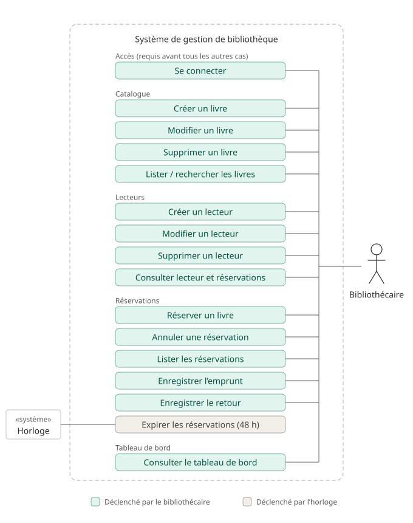

# Diagramme de cas d'utilisation : Gestion de Bibliothèque

Kata Kainaa, stage Développeur Full Stack.
Ce document identifie les **acteurs** et leurs **cas d'utilisation**, avec la justification de chaque choix. Il sert de base à la modélisation et au README.

## 1. Diagramme

Légende : teal = cas déclenché par le bibliothécaire ; gris = cas déclenché par l'horloge.

## 2. Acteurs

**Définition retenue.** Un acteur est une entité extérieure au système qui interagit directement avec lui pour atteindre un but. C'est un rôle, pas forcément une personne.

| Acteur | Type | Justification |
| --- | --- | --- |
| **Bibliothécaire** | humain | Il est le seul à utiliser le système, après s'être authentifié : il alimente le catalogue, inscrit les lecteurs, saisit les réservations, annulations, emprunts et retours, et pilote la bibliothèque via le tableau de bord. La bibliothèque est le client (« moderniser sa gestion »). |
| **Horloge** | non humain («système») | « Expire automatiquement » : personne ne clique, c'est le temps (48 h écoulées) qui déclenche l'expiration. Dessinée en rectangle, car ce n'est pas une personne. |

### Pourquoi le lecteur n'est pas un acteur

Dans le périmètre fonctionnel du kata, le lecteur n'interagit à aucun moment directement avec le système : c'est le bibliothécaire qui saisit ses demandes. Le lecteur est donc une **donnée du domaine** (une entité avec un nom, un e-mail et des réservations), comme un livre. Il est le bénéficiaire des actions, pas leur auteur.

La phrase « un lecteur peut réserver » de l'énoncé est une règle du métier (le lecteur a le droit de réserver), pas une indication sur qui saisit la commande. Le pseudo-code de l'énoncé va dans le même sens : `reserver_livre(livre_id, lecteur_id)` reçoit le lecteur comme un paramètre.

Le lecteur deviendrait un acteur si on ajoutait une interface qui lui est destinée (bonus mobile, borne en libre-service). Le bonus est écarté tant que le périmètre fonctionnel n'est pas terminé proprement.

## 3. Cas d'utilisation

| # | Cas d'utilisation | Acteur | Justification |
| --- | --- | --- | --- |
| 1 | Se connecter | Bibliothécaire | Il est le seul à utiliser le système : l'accès doit être protégé (sécurité). Requis avant tous les autres cas du bibliothécaire. |
| 2 | Créer un livre | Bibliothécaire | Il tient le catalogue. |
| 3 | Modifier un livre | Bibliothécaire | Idem. |
| 4 | Supprimer un livre | Bibliothécaire | Idem. |
| 5 | Lister / rechercher les livres | Bibliothécaire | Il cherche le livre demandé par le lecteur avant de le réserver. |
| 6 | Créer un lecteur | Bibliothécaire | Il inscrit le lecteur : le lecteur n'utilise pas le système. |
| 7 | Modifier un lecteur | Bibliothécaire | Idem. |
| 8 | Supprimer un lecteur | Bibliothécaire | Idem. |
| 9 | Consulter un lecteur et ses réservations en cours | Bibliothécaire | La fiche contient des données personnelles, destinées à la gestion. Il peut y vérifier le quota de 3 quand un lecteur se présente. |
| 10 | Réserver un livre | Bibliothécaire | Il saisit la demande du lecteur : la requête fournit l'identifiant du lecteur et celui du livre. |
| 11 | Annuler une réservation | Bibliothécaire | Il saisit l'annulation demandée par le lecteur. |
| 12 | Lister les réservations | Bibliothécaire | Vue de gestion « livre ↔ lecteur ↔ date ». |
| 13 | Enregistrer l'emprunt | Bibliothécaire | Il constate la sortie physique du livre. L'énoncé ne le précise pas : hypothèse. |
| 14 | Enregistrer le retour | Bibliothécaire | Il constate le retour physique du livre. Hypothèse. |
| 15 | Expirer les réservations (48 h) | Horloge | « Expire automatiquement » : déclenché par le temps. L'horloge doit être contrôlable dans les tests. |
| 16 | Consulter le tableau de bord | Bibliothécaire | Livres disponibles vs indisponibles, réservations par lecteur : un outil de pilotage. |

## 4. Rappel du cycle de vie d'une réservation

Une réservation naît « réservée » et n'avance que vers l'avant. Les états retournée, annulée et expirée sont terminaux.

| Transition autorisée | Déclencheur |
| --- | --- |
| réservée → empruntée | Bibliothécaire (cas 13) |
| réservée → annulée | Bibliothécaire (cas 11) |
| réservée → expirée | Horloge (cas 15) |
| empruntée → retournée | Bibliothécaire (cas 14) |

Une réservation est **active** quand elle est réservée ou empruntée. Un livre est **disponible** quand il n'a aucune réservation active.

## 5. Règles de gestion

Règles métier validées, rattachées aux cas d'utilisation. Elles appartiennent à la couche domaine, sauf RG1 dont la garantie finale revient à la base de données.

| # | Règle | Cas concernés |
| --- | --- | --- |
| RG1 | Un livre a au plus **une réservation active** à la fois. Garantie en concurrence par une contrainte d'unicité partielle en base (états actifs seulement). Le refus devient une erreur métier explicite (409). | 10 |
| RG2 | Un lecteur a au plus **3 réservations actives** (réservée ou empruntée). Le quota est vérifié à la **création** d'une réservation ; passer de « réservée » à « empruntée » ne change pas le total. | 10, 13 |
| RG3 | Un livre est **disponible** quand il n'a aucune réservation active. Cette information est déduite, jamais stockée. | 5, 10, 16 |
| RG4 | Les transitions d'état invalides sont refusées. Retournée, annulée et expirée sont des états terminaux. | 11, 13, 14, 15 |
| RG5 | Une réservation non retirée sous 48 h passe à « expirée » et libère le livre. L'horloge doit être contrôlable dans les tests. | 15 |
| RG6 | L'e-mail d'un lecteur est unique. | 6, 7 |
| RG7 | Un livre déjà emprunté ne peut pas être réservé. | 10 |
| RG8 | Le compte du bibliothécaire est créé à l'installation, sans inscription publique. Il n'y a donc aucun cas d'utilisation de création de compte. | 1 |

## 6. Hypothèses à reporter dans le README

- Le lecteur n'est pas un acteur : le bibliothécaire saisit toutes ses demandes (le lecteur est une donnée du domaine).
- Le bibliothécaire s'authentifie avant d'utiliser le système (choix de sécurité, absent de l'énoncé). L'horloge est interne au système et ne s'authentifie pas.
- Le compte du bibliothécaire est créé à l'installation (commande ou script), sans inscription publique : une interface de création de comptes serait de la sur-ingénierie pour ce kata.
- On ne peut pas emprunter un livre sans réservation préalable (lecture stricte du cycle de vie).
- L'emprunt et le retour sont enregistrés par le bibliothécaire (l'énoncé ne le précise pas).
- Un livre déjà emprunté ne peut pas être réservé.
- La disponibilité d'un livre est déduite des réservations, sans champ stocké.
- Le bonus mobile est écarté ; il ferait du lecteur un acteur.

## 7. Points encore à trancher

- Expiration : job planifié ou calcul à la lecture ? (À décider en tenant compte de RG1 : une réservation périmée mais encore « réservée » en base bloquerait le livre.)
- Suppression d'un livre ou d'un lecteur qui a des réservations : refuser, supprimer en cascade, ou suppression logique ?
- Code HTTP quand le quota est dépassé : 409 ou 422 ?
- Nombre de comptes bibliothécaires créés à l'installation : un seul ou plusieurs ?
