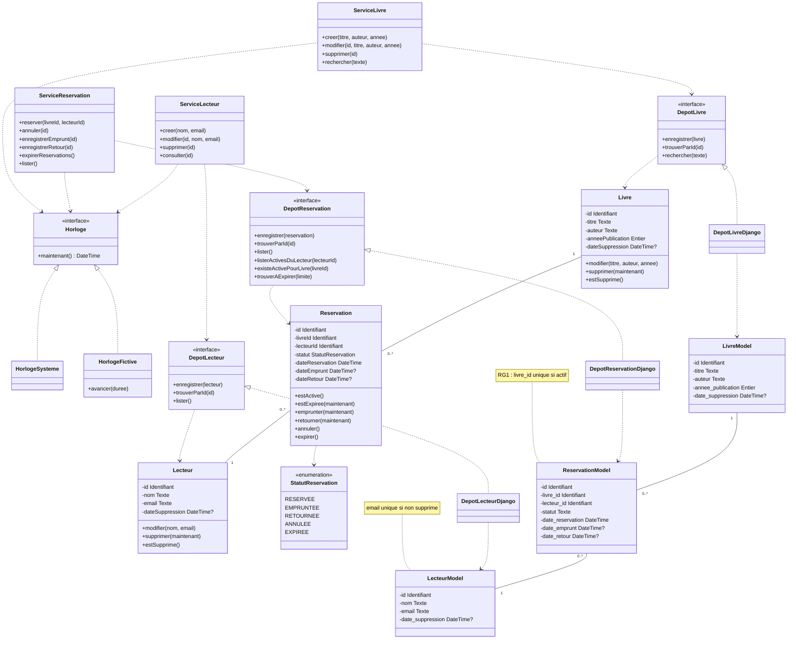

# Diagramme de classes : Gestion de bibliothèque

Ce document décrit en texte le diagramme `diagramme_classes.svg` : chaque classe, ses attributs, ses méthodes, ses relations et les règles de gestion. Le SVG reste la référence visuelle ; ce fichier porte aussi les dépendances que le dessin ne montre pas.

**Conventions**

- `-` attribut privé, `+` méthode publique.
- `?` après un type = valeur optionnelle (`[0..1]` dans le SVG).
- Couleurs du SVG : **vert** = entités pures, **gris** = services, interfaces et horloge (Python pur), **orange** = classes Django (hors domaine).

---

## 1. Les couches

| Couche | Rôle | Classes | Connaît Django ? |
|---|---|---|---|
| Entités | Portent les données **et les règles métier** | `Livre`, `Reservation`, `Lecteur`, `StatutReservation` | Non |
| Services | Orchestrent les cas d'usage, appliquent les règles qui dépassent une entité | `ServiceLivre`, `ServiceReservation`, `ServiceLecteur` | Non |
| Interfaces | Contrats d'accès aux données (liste de méthodes, sans code) | `DepotLivre`, `DepotReservation`, `DepotLecteur`, `Horloge` | Non |
| Horloge | Fournit l'heure, réelle ou contrôlée | `HorlogeSysteme`, `HorlogeFictive` | Non |
| Django | Réalisent les interfaces et parlent à la base | `DepotLivreDjango`, `DepotReservationDjango`, `DepotLecteurDjango`, `LivreModel`, `ReservationModel`, `LecteurModel` | Oui |

**Principe central** : seuls les dépôts Django voient les modèles Django. Services et dépôts échangent uniquement des **entités pures**.

---

## 2. Horloge

| Classe | Stéréotype | Contenu |
|---|---|---|
| `Horloge` | interface pure | `+ maintenant() : DateTime` |
| `HorlogeSysteme` | pur | heure réelle |
| `HorlogeFictive` | pur | `+ avancer(durée)` : heure contrôlée pour les tests |

`HorlogeSysteme` et `HorlogeFictive` **réalisent** `Horloge`. Les services ne connaissent que `Horloge` et la reçoivent en injection.

---

## 3. Entités pures

### `Livre`

| Attributs | Méthodes |
|---|---|
| `- id : Identifiant` | `+ modifier(titre, auteur, annee)` |
| `- titre : Texte` | `+ supprimer(maintenant)` |
| `- auteur : Texte` | `+ estSupprime()` |
| `- anneePublication : Entier` | |
| `- dateSuppression : DateTime?` | |

Il n'y a **pas de champ « disponible »** : la disponibilité se déduit des réservations (voir `DepotReservation.existeActivePourLivre`).

### `Reservation`

| Attributs | Méthodes |
|---|---|
| `- id : Identifiant` | `+ estActive()` |
| `- livreId : Identifiant` | `+ estExpiree(maintenant)` |
| `- lecteurId : Identifiant` | `+ emprunter(maintenant)` |
| `- statut : StatutReservation` | `+ retourner(maintenant)` |
| `- dateReservation : DateTime` | `+ annuler()` |
| `- dateEmprunt : DateTime?` | `+ expirer()` |
| `- dateRetour : DateTime?` | |

La réservation référence le livre et le lecteur **par identifiant** (`livreId`, `lecteurId`), pas par objet.

### `Lecteur`

| Attributs | Méthodes |
|---|---|
| `- id : Identifiant` | `+ modifier(nom, email)` |
| `- nom : Texte` | `+ supprimer(maintenant)` |
| `- email : Texte` | `+ estSupprime()` |
| `- dateSuppression : DateTime?` | |

### `StatutReservation` (énumération)

`RESERVEE`, `EMPRUNTEE`, `RETOURNEE`, `ANNULEE`, `EXPIREE`

Cycle de vie selon l'énoncé : `RESERVEE → EMPRUNTEE → RETOURNEE`, avec `ANNULEE` ou `EXPIREE` comme autres issues. Les transitions invalides sont refusées par la `Reservation` elle-même.

---

## 4. Interfaces de dépôt

| Interface | Méthodes |
|---|---|
| `DepotLivre` | `+ enregistrer(livre)` · `+ trouverParId(id)` · `+ rechercher(texte)` |
| `DepotReservation` | `+ enregistrer(reservation)` · `+ trouverParId(id)` · `+ lister()` · `+ listerActivesDuLecteur(lecteurId)` · `+ existeActivePourLivre(livreId)` · `+ trouverAExpirer(limite)` |
| `DepotLecteur` | `+ enregistrer(lecteur)` · `+ trouverParId(id)` · `+ lister()` |

---

## 5. Services

| Service | Méthodes |
|---|---|
| `ServiceLivre` | `+ creer(titre, auteur, annee)` · `+ modifier(id, titre, auteur, annee)` · `+ supprimer(id)` · `+ rechercher(texte)` |
| `ServiceReservation` | `+ reserver(livreId, lecteurId)` · `+ annuler(id)` · `+ enregistrerEmprunt(id)` · `+ enregistrerRetour(id)` · `+ expirerReservations()` · `+ lister()` |
| `ServiceLecteur` | `+ creer(nom, email)` · `+ modifier(id, nom, email)` · `+ supprimer(id)` · `+ consulter(id)` |

---

## 6. Classes Django

### Dépôts Django

`DepotLivreDjango`, `DepotReservationDjango` et `DepotLecteurDjango` font chacun deux choses :

- **réalisent** l'interface de dépôt correspondante ;
- **convertissent modèle ↔ entité** (entité → modèle à l'enregistrement, modèle → entité à la lecture).

### Modèles Django

| Modèle | Attributs | Contrainte |
|---|---|---|
| `LivreModel` | `id`, `titre`, `auteur`, `annee_publication : Entier`, `date_suppression : DateTime?` | |
| `ReservationModel` | `id`, `livre_id (FK)`, `lecteur_id (FK)`, `statut : Texte`, `date_reservation`, `date_emprunt?`, `date_retour?` | **RG1** : `livre_id` unique si la réservation est active |
| `LecteurModel` | `id`, `nom`, `email`, `date_suppression : DateTime?` | `email` unique si non supprimé |

Différence clé avec l'entité : `ReservationModel.statut` est un **texte** (ex. `"RESERVEE"`), alors que `Reservation.statut` est une **énumération**. Les modèles n'ont aucune méthode métier.

---

## 7. Relations du diagramme

| De | Vers | Nature |
|---|---|---|
| `HorlogeSysteme`, `HorlogeFictive` | `Horloge` | réalisation |
| Cadre « Services » | `Horloge` | dépendance : les services reçoivent l'horloge |
| `ServiceLivre` | `DepotLivre` | dépendance |
| `ServiceReservation` | `DepotReservation` | dépendance |
| `ServiceLecteur` | `DepotLecteur` | dépendance |
| `DepotLivre` | `Livre` | manipule des entités |
| `DepotReservation` | `Reservation` | manipule des entités |
| `DepotLecteur` | `Lecteur` | manipule des entités |
| `Livre` 1 — 0..* `Reservation` | | association : un livre a 0 à n réservations |
| `Reservation` 0..* — 1 `Lecteur` | | association : un lecteur a 0 à n réservations |
| `Reservation` | `StatutReservation` | utilise l'énumération |
| `DepotLivreDjango`, `DepotReservationDjango`, `DepotLecteurDjango` | interfaces `DepotLivre`, `DepotReservation`, `DepotLecteur` | réalisation |
| Dépôts Django | modèles correspondants | utilisent |
| `LivreModel` 1 — 0..* `ReservationModel` | | association |
| `ReservationModel` 0..* — 1 `LecteurModel` | | association |

---

## 8. Règles de gestion

- **RG1** : au plus **une réservation active par livre**, garantie **par la base** (contrainte d'unicité sur `ReservationModel`). Une contrainte de base est atomique : elle refuse la seconde écriture même si deux demandes arrivent en même temps.
- **RG2** : au plus **3 réservations actives par lecteur**, vérifiée **par le service** (comptage via `listerActivesDuLecteur`, puis acceptation ou refus).
- **Validation** : la forme de la requête est vérifiée à l'entrée ; la validation métier (titre, année, e-mail) est dans les **entités**.
- **Horloge** : les entités reçoivent l'heure **en paramètre** (`supprimer(maintenant)`, `estExpiree(maintenant)`, `emprunter(maintenant)`, `retourner(maintenant)`) ; elles ne lisent jamais l'horloge elles-mêmes, ce qui les rend déterministes et testables. C'est le **service** qui appelle `Horloge.maintenant()`.
- **Suppression logique** : `Livre` et `Lecteur` portent une `dateSuppression` au lieu d'être effacés.
- **E-mail** : unique parmi les lecteurs non supprimés.

---

## 9. Dépendances non dessinées

Le SVG ne trace pas tous les appels. Ceux-ci sont déduits des opérations listées ci-dessus ; ils sont à confirmer au moment de coder.

- `ServiceLivre` et `ServiceLecteur` utilisent aussi `Horloge` (pour `dateSuppression`).
- `ServiceReservation.reserver` doit retrouver le livre et le lecteur : usage de `DepotLivre.trouverParId` et `DepotLecteur.trouverParId`.
- `ServiceReservation.reserver` applique RG2 avec `DepotReservation.listerActivesDuLecteur` et vérifie la disponibilité avec `DepotReservation.existeActivePourLivre`.
- `ServiceReservation.expirerReservations` utilise `Horloge` et `DepotReservation.trouverAExpirer(limite)`.
- `ServiceLecteur.consulter` doit afficher les réservations en cours du lecteur : usage de `DepotReservation.listerActivesDuLecteur`.

---

## 10. Points encore ouverts

- **Expiration** : job planifié, ou vérification à l'opération. Ce choix touche à l'unicité RG1 : une réservation expirée mais non enregistrée comme telle occupe encore la place dans la contrainte.
- **Code HTTP du dépassement de quota** : 409 ou 422.
- **Unicité partielle de l'e-mail** : dépend de la base choisie (les contraintes d'unicité conditionnelles ne sont pas disponibles partout).
- **Définition d'« active »** : `RESERVEE` seule, ou `RESERVEE` + `EMPRUNTEE`. Elle intervient dans RG1, RG2 et l'index d'unicité.
- **Transitions** : états depuis lesquels `annuler` et `expirer` sont permis.

---

## 11. Schéma Mermaid

